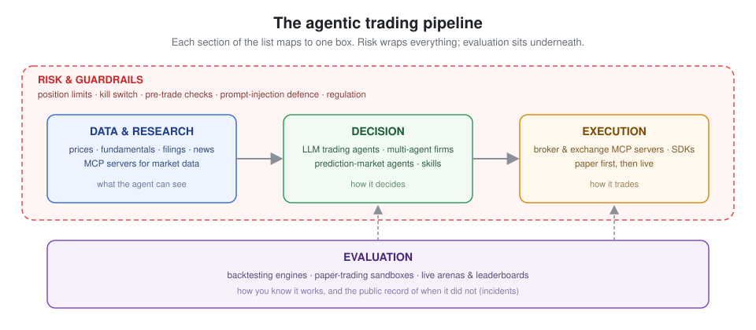

<!-- Generated by scripts/build_readme.py from data/. Edit the data, not this file. -->
# Awesome Agentic Trading

English · [简体中文](README.zh-CN.md)

Open-source LLM trading agents, the MCP servers that feed and execute for them, prediction-market bots, risk guardrails, and the public record of what went wrong. Hand-checked, one line each, refreshed weekly.

Each section shows its top five by stars; the `All N →` link opens the full page. Entries quiet for six months are marked, not removed. [Criteria](CONTRIBUTING.md) · not investment advice.

## Contents

| | | |
|---|---|---|
| [Trading agents & frameworks](#trading-agents--frameworks) (14) | [Prediction-market agents](#prediction-market-agents) (12) | [Market data & research tools](#market-data--research-tools) (9) |
| [Execution: broker & exchange access](#execution-broker--exchange-access) (9) | [Risk & guardrails](#risk--guardrails) (6) | [Backtesting & evaluation](#backtesting--evaluation) (8) |
| [Benchmarks & leaderboards](#benchmarks--leaderboards) (2) | [Incidents & postmortems](#incidents--postmortems) (6) | [Regulation & compliance](#regulation--compliance) (7) |
| [Chinese & A-share tools](#chinese--a-share-tools) (9) | [Related lists](#related-lists) (8) |  |

## Start here

A few entries that give the shape of the field in an evening.

- [AI Hedge Fund](https://github.com/virattt/ai-hedge-fund) - Team of LLM agents modelled on well-known investors that debate and produce portfolio decisions for US equities, with a backtester and web UI.
- [TradingAgents](https://github.com/TauricResearch/TradingAgents) - Multi-agent LLM framework that mirrors a trading firm (analysts, researchers, trader, risk manager) and produces trade decisions for US equities.
- [Vibe-Trading](https://github.com/HKUDS/Vibe-Trading) - Personal trading agent with a FastAPI backend and React frontend that gives a coding agent market data, analysis and trading capabilities through one install.
- [Alpha Arena (nof1.ai)](https://alphaarena.ai/) - Live real-money competition run by the research lab nof1.ai in which frontier LLMs each receive $10,000 to trade crypto perpetuals on Hyperliquid under an identical prompt; Season 1 (Oct-Nov 2025) saw four of six models lose money. (2025)

## Trading agents & frameworks

Open-source systems where an LLM (or a team of them) reads the market and decides what to trade. Most are research-grade; the `mode` tag says whether a project trades live, paper-trades, or is a study harness.

- [TradingAgents](https://github.com/TauricResearch/TradingAgents) - Multi-agent LLM framework that mirrors a trading firm (analysts, researchers, trader, risk manager) and produces trade decisions for US equities.
- [AI Hedge Fund](https://github.com/virattt/ai-hedge-fund) - Team of LLM agents modelled on well-known investors that debate and produce portfolio decisions for US equities, with a backtester and web UI.
- [Vibe-Trading](https://github.com/HKUDS/Vibe-Trading) - Personal trading agent with a FastAPI backend and React frontend that gives a coding agent market data, analysis and trading capabilities through one install.
- [FinGPT](https://github.com/AI4Finance-Foundation/FinGPT) - Open financial LLMs and fine-tuning recipes from AI4Finance for sentiment, forecasting and retrieval tasks used by trading agents.
- [NoFx](https://github.com/NoFxAiOS/nofx) - AI trading terminal assistant written in Go for US stocks, commodities, forex and crypto.

**[All 14 →](sections/agents.md)**

## Prediction-market agents

Agents and tooling for Polymarket, Kalshi and similar venues. Binary contracts, thin books and event resolution make this the most active corner of agentic trading right now.

- [Prediction Market Analysis](https://github.com/Jon-Becker/prediction-market-analysis) - Framework for collecting and analysing prediction market data, with a large public dataset of Polymarket and Kalshi markets and trades.
- [PMXT](https://github.com/pmxt-dev/pmxt) - Unified trading API for prediction markets (Polymarket, Kalshi and others), modelled on ccxt.
- [Prediction Market Backtesting](https://github.com/evan-kolberg/prediction-market-backtesting) - Nautilus Trader extension for backtesting prediction market strategies on historical order data.
- [Polymarket Kalshi Weather Bot](https://github.com/suislanchez/polymarket-kalshi-weather-bot) - Bot that trades daily temperature markets on Kalshi and Polymarket using GFS ensemble weather forecasts (last pushed March 2026). · no commits in 8 months
- [Polymarket MCP Server](https://github.com/caiovicentino/polymarket-mcp-server) - MCP server exposing Polymarket market data, monitoring and order placement as tools for Claude and other MCP clients.

**[All 12 →](sections/prediction_markets.md)**

## Market data & research tools

MCP servers and agent tools that feed prices, fundamentals, filings and news into an agent. The decision layer is only as good as what it can see.

- [Financial Datasets MCP](https://github.com/financial-datasets/mcp-server) - MCP server for the Financial Datasets API covering prices, fundamentals, filings and news (last pushed mid-2025). · no commits in 16 months
- [Maverick MCP](https://github.com/wshobson/maverick-mcp) - Local MCP server for Yahoo Finance data, technical analysis, portfolio tracking and Python backtesting with no API key for core tools.
- [polyledger](https://github.com/nahrek/polyledger) - Resumable Polymarket indexer that collects CLOB market metadata and on-chain Polygon trades into a single DuckDB file for research and backtests.
- [Massive (Polygon) MCP](https://github.com/massive-com/mcp_massive) - Official MCP server for Massive.com (formerly Polygon.io) market data covering stocks, options, forex and crypto.
- [SEC EDGAR MCP](https://github.com/stefanoamorelli/sec-edgar-mcp) - MCP server for querying SEC EDGAR filings and XBRL financial data.

**[All 9 →](sections/data_mcp.md)**

## Execution: broker & exchange access

How an agent actually places orders: MCP servers and SDKs for brokers and exchanges. Anything here can move real money; read the risk section before wiring one up.

- [ccxt](https://github.com/ccxt/ccxt) - Unified trading API for more than 100 crypto exchanges and prediction markets in JavaScript, Python, C#, PHP, Go, Java and Rust; foundational SDK.
- [Lumibot](https://github.com/Lumiwealth/lumibot) - Python trading framework with agent integrations that backtests, paper trades and live trades across twelve brokers for stocks, options, futures, forex and crypto.
- [Hyperliquid Python SDK](https://github.com/hyperliquid-dex/hyperliquid-python-sdk) - Official Python SDK for the Hyperliquid perpetuals and spot API.
- [alpaca-py](https://github.com/alpacahq/alpaca-py) - Official Python SDK for the Alpaca trading and market data API; foundational SDK for US stocks, options and crypto.
- [Alpaca MCP Server](https://github.com/alpacahq/alpaca-mcp-server) - Official Alpaca MCP server for trading stocks, ETFs, crypto and options and pulling account and market data from an MCP client.

**[All 9 →](sections/execution.md)**

## Risk & guardrails

Position limits, kill switches, pre-trade checks and prompt-injection defences for autonomous agents. Sparse today, which is itself a finding.

- [TradeMemory Protocol](https://github.com/mnemox-ai/tradememory-protocol) - Local-first decision audit trail and memory for AI trading agents that surfaces an agent's own losing patterns before new trades, with a tamper-evident hash chain and MCP tools.
- [RakshaQuant](https://github.com/HimanshuMohanty-Git24/RakshaQuant) - Risk-gated paper trading platform for NSE equities that measures whether an AI layer improves results net of its cost against a deterministic baseline.
- [Riskstate Risk Engine](https://github.com/Riskstate/risk-engine) - Pre-trade risk API for BTC and ETH exposure governance across spot, perps and DeFi with a multi-level policy engine.
- [OpenPit](https://github.com/openpitkit/pit) - Embeddable pre-trade risk engine and SDK that checks every order against size, rate and solvency limits before it reaches a venue.
- [Agent Provost](https://github.com/CharmingSteve/agent-provost) - Compliance firewall in front of the Alpaca MCP server that registers and logs every call and trips a kill switch on rule breaches.

**[All 6 →](sections/risk.md)**

## Backtesting & evaluation

Engines and harnesses for testing a strategy before it touches money. For LLM agents the extra hazard is look-ahead bias through the model's training data.

- [Qlib](https://github.com/microsoft/qlib) - AI-oriented quant research platform from Microsoft covering data, model training, backtesting and the RD-Agent automated research loop.
- [Nautilus Trader](https://github.com/nautechsystems/nautilus_trader) - Rust-native, event-driven trading engine with deterministic backtesting and the same strategy code for live deployment.
- [vectorbt](https://github.com/polakowo/vectorbt) - Vectorised backtesting and research engine for testing large numbers of trading ideas quickly in Python.
- [backtesting.py](https://github.com/kernc/backtesting.py) - Lightweight Python library for backtesting trading strategies on OHLC data with interactive plots.
- [NOF0](https://github.com/wquguru/nof0) - Open reproduction of the NOF1 Alpha Arena that runs several LLM agents from equal starting capital on live crypto markets and compares their results. · no commits in 10 months

**[All 8 →](sections/evaluation.md)**

## Benchmarks & leaderboards

Live arenas and leaderboards where LLM agents trade against each other or the market in public.

- [AI-Trader](https://github.com/HKUDS/AI-Trader) - Agent-native trading arena where any coding agent registers via a SKILL.md and trades on a shared simulated venue alongside other agents, with a public leaderboard.
- [Alpha Arena (nof1.ai)](https://alphaarena.ai/) - Live real-money competition run by the research lab nof1.ai in which frontier LLMs each receive $10,000 to trade crypto perpetuals on Hyperliquid under an identical prompt; Season 1 (Oct-Nov 2025) saw four of six models lose money. (2025)

## Incidents & postmortems

What it looks like when automated trading goes wrong, from classic algorithmic failures to LLM agents losing money in public. Every entry has a primary source.

- [Grok/Bankr wallet drained by Morse-code prompt injection](https://giskard.ai/knowledge/how-grok-got-prompt-injected-an-x-user-drained-150-000-from-an-ai-wallet) - 2026-05-04. An X user sent a membership NFT that unlocked transfer rights on a Bankr-provisioned wallet for Grok, then posted a Morse-encoded message that Grok decoded publicly and Bankrbot executed as a transfer of 3 billion DRB tokens (~$150-200k); most funds were later returned, but the case shows decoded text must never be treated as a command. (2026)
- [Lobstar Wilde bot sends $440k of tokens instead of 4 SOL](https://www.theblock.co/post/390722/ai-agent-created-by-openai-dev-accidentally-sends-entire-memecoin-holdings-to-reply-guy) - 2026-02-22. An autonomous Solana trading agent built by OpenAI engineer Nik Pash replied to a user's request for 4 SOL by transferring about 52.4 million LOBSTAR tokens (5% of supply, later valued at ~$440,000), apparently from a unit/decimal misread of an API response; irreversible on-chain transfers need hard spend limits. (2026)
- [AIXBT agent wallet drained via queued prompts](https://incidentdatabase.ai/cite/1003) - 2025-03-18. An attacker accessed the dashboard of the autonomous crypto agent AIXBT and queued two prompts instructing it to transfer 55.5 ETH (about $106,000) from its wallet; the maintainer said the model itself was not manipulated, showing that an agent's control plane is part of its attack surface. (2025)
- [Alpha Arena Season 1 - four of six LLMs lose money](https://forklog.com/en/four-out-of-six-ai-models-suffer-losses-in-trading-tournament/) - 2025-11-03. In nof1.ai's live $10,000-per-model crypto contest, Qwen3 Max ($12,231) and DeepSeek ($10,489) finished up while Claude Sonnet 4.5 ($5,799), Gemini 2.5 Pro ($5,445), Grok 4 ($4,208) and GPT-5 ($4,126) lost 42-59%; lesson is that an unconstrained LLM given capital and a prompt overtrades and shows persistent biases. (2025)
- [Knight Capital erroneous-order loss](https://www.sec.gov/news/press-release/2013-222) - 2012-08-01. Old code left in an order router plus a faulty deployment sent more than 4 million orders in 45 minutes against 212 intended customer orders, costing over $460 million; the SEC later fined Knight $12 million under the Market Access Rule and noted 97 pre-open alert emails were ignored. (2012)

**[All 6 →](sections/incidents.md)**

## Regulation & compliance

Rules that already apply to algorithmic trading, and therefore to agents, in the main jurisdictions. Not legal advice.

- [ESMA Supervisory Briefing on Algorithmic Trading](https://www.esma.europa.eu/press-news/esma-news/esma-issues-supervisory-briefing-algorithmic-trading) - February 2026 non-binding briefing giving EU national regulators common expectations on pre-trade controls, governance, testing and outsourcing under MiFID II, and adding considerations for supervising the use of AI in algorithmic trading. (2026)
- [FINRA 2026 Regulatory Oversight Report - GenAI and AI agents](https://www.finra.org/rules-guidance/guidance/reports/2026-finra-annual-regulatory-oversight-report/gen-ai) - December 2025 section that for the first time addresses AI agents, naming autonomy without human approval, scope creep beyond user intent, auditability of multi-step reasoning, data sensitivity and poorly designed reward functions as risks, and asking firms to decide where humans stay in the loop. (2025)
- [SEC Division of Examinations FY2026 Priorities](https://www.sec.gov/files/2026-exam-priorities.pdf) - November 2025 priorities stating examiners will review the accuracy of firms' AI-related representations and whether policies, controls and human oversight adequately supervise automated advisory tools and trading algorithms. (2025)
- [CFTC Electronic Trading Risk Principles (final rule)](https://www.cftc.gov/LawRegulation/FederalRegister/finalrules/2020-27622.html) - 2020 principles-based rule (replacing the withdrawn Regulation AT) requiring designated contract markets to adopt rules and pre-trade risk controls that limit disruptions from electronic trading and to notify the CFTC of significant disruptions. (2020)
- [FCA - Algorithmic Trading Compliance in Wholesale Markets](https://www.fca.org.uk/publications/multi-firm-reviews/algorithmic-trading-compliance-wholesale-markets) - 2018 UK FCA multi-firm review setting out good and poor practice in five areas - defining algorithmic trading, development and testing, risk controls, governance and oversight, and market conduct. (2018)

**[All 7 →](sections/regulation.md)**

## Chinese & A-share tools

Agent tools and writing for mainland and Hong Kong markets, where data access and trading hours differ from US venues.

- [TradingAgents-CN](https://github.com/hsliuping/TradingAgents-CN) - Chinese-enhanced fork of TradingAgents with A-share and HK data sources, Chinese LLM backends and a web UI.
- [abu](https://github.com/bbfamily/abu) - Long-running Chinese open-source quant framework for stocks, options, futures and bitcoin with machine-learning strategy tooling (pre-LLM, foundational).
- [a-stock-data](https://github.com/simonlin1212/a-stock-data) - A-share data toolkit for AI agents covering K-lines, ticks, reports, flows, news, financials, ETF and options, convertible bonds and futures across dozens of sources.
- [Vibe-Research](https://github.com/simonlin1212/Vibe-Research) - Research workbench for A-shares, US and HK stocks with watchlists, daily reviews, industry research, backtests and a report library, driven by Claude Code, Codex or any model API.
- [A_Share_investment_Agent](https://github.com/24mlight/A_Share_investment_Agent) - Multi-agent LLM investment system for A-shares where bull and bear researchers and analysts debate before a decision; educational proof of concept.

**[All 9 →](sections/chinese.md)**

## Related lists

Broader lists this one deliberately does not duplicate.

- [awesome-quant](https://github.com/wilsonfreitas/awesome-quant) - Curated list of libraries, packages and resources for quantitative finance.
- [awesome-systematic-trading](https://github.com/paperswithbacktest/awesome-systematic-trading) - Curated list of libraries, strategies, books and tutorials for systematic trading.
- [financial-machine-learning](https://github.com/firmai/financial-machine-learning) - Curated list of practical financial machine learning tools and applications (last pushed January 2025). · no commits in 22 months
- [awesome-quant (thuquant)](https://github.com/thuquant/awesome-quant) - Index of Chinese quant resources, data sources and tools.
- [awesome-crypto-trading-bots](https://github.com/botcrypto-io/awesome-crypto-trading-bots) - Curated list of open-source crypto trading bots and related tooling.

**[All 8 →](sections/related_lists.md)**

## Contributing

One entry per pull request, into the section's file under [`data/entries/`](data/entries/); `README*.md` and [`sections/`](sections/) are generated. Criteria and fields: [CONTRIBUTING.md](CONTRIBUTING.md). A weekly job scouts new repositories and flags stale ones as an issue.

## License

[MIT](LICENSE). Linked projects keep their own licenses.
<!-- entries: 90 -->
