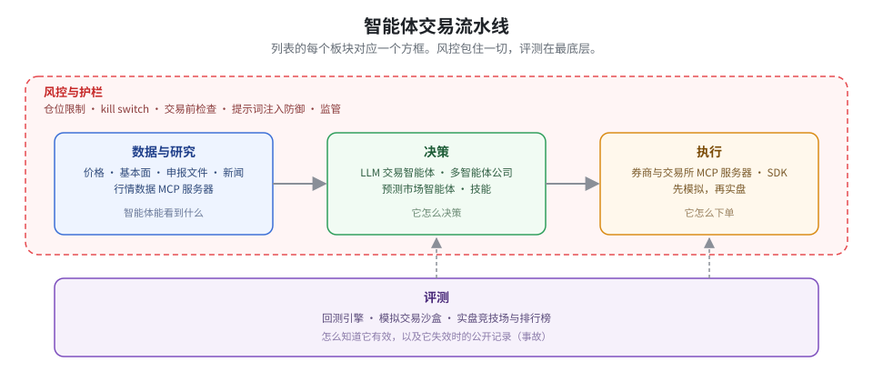

<!-- 由 scripts/build_readme.py 根据 data/ 生成。请修改数据文件，不要直接改这个文件。 -->
# Awesome Agentic Trading

[English](README.md) · 简体中文

开源的 LLM 交易智能体、为它们提供数据和执行的 MCP 服务器、预测市场机器人、风控护栏，以及出过事的公开记录。逐条人工核过，一条一行，每周刷新。

每个板块只列按 star 排的前五条，`全部 N 条 →` 打开完整页面。半年没动静的条目会被标注而不是删除。[每周周报](reports/README.md) · [收录标准](CONTRIBUTING.md) · 不构成投资建议。

## 目录

| | | |
|---|---|---|
| [交易智能体与框架](#交易智能体与框架) (14) | [预测市场智能体](#预测市场智能体) (12) | [行情数据与研究工具](#行情数据与研究工具) (9) |
| [执行：券商与交易所接入](#执行券商与交易所接入) (9) | [风控与护栏](#风控与护栏) (6) | [回测与评测](#回测与评测) (9) |
| [基准与排行榜](#基准与排行榜) (2) | [事故与复盘](#事故与复盘) (6) | [监管与合规](#监管与合规) (7) |
| [中文资源 · A 股工具](#中文资源--a-股工具) (9) | [相关列表](#相关列表) (8) |  |

## 从这里开始

一个晚上就能看出这个领域大致轮廓的几条。

- [AI Hedge Fund](https://github.com/virattt/ai-hedge-fund) - 一组以知名投资人为原型的 LLM 智能体，相互辩论后给出美股组合决策，自带回测器和 Web 界面。
- [TradingAgents](https://github.com/TauricResearch/TradingAgents) - 模拟一家交易公司（分析师、研究员、交易员、风控经理）的多智能体 LLM 框架，输出美股交易决策。
- [Vibe-Trading](https://github.com/HKUDS/Vibe-Trading) - 个人交易智能体，FastAPI 后端加 React 前端，一次安装即可让编码智能体获得行情、分析和交易能力。
- [Alpha Arena (nof1.ai)](https://alphaarena.ai/) - 研究机构 nof1.ai 举办的真金实盘比赛，每个前沿 LLM 领取 1 万美元，在相同提示词下交易 Hyperliquid 加密永续合约；第一季（2025 年 10 至 11 月）六个模型中四个亏损。 (2025)

## 交易智能体与框架

由 LLM（或一组 LLM）读取市场并决定交易什么的开源系统。多数是研究级，`mode` 标签说明项目是实盘、模拟交易还是研究用途。

- [TradingAgents](https://github.com/TauricResearch/TradingAgents) - 模拟一家交易公司（分析师、研究员、交易员、风控经理）的多智能体 LLM 框架，输出美股交易决策。
- [AI Hedge Fund](https://github.com/virattt/ai-hedge-fund) - 一组以知名投资人为原型的 LLM 智能体，相互辩论后给出美股组合决策，自带回测器和 Web 界面。
- [Vibe-Trading](https://github.com/HKUDS/Vibe-Trading) - 个人交易智能体，FastAPI 后端加 React 前端，一次安装即可让编码智能体获得行情、分析和交易能力。
- [FinGPT](https://github.com/AI4Finance-Foundation/FinGPT) - AI4Finance 出品的开源金融大模型和微调方案，面向交易智能体常用的情绪分析、预测和检索任务。
- [NoFx](https://github.com/NoFxAiOS/nofx) - 自托管的 Go 语言 AI 交易系统：Frontier 模式生成入场方案由你逐笔批准，Autopilot 模式按配置的策略持续运行；订单路由到 Binance USDT 永续、Hyperliquid、OKX 和 Bitget。

**[全部 14 条 →](sections/agents.zh-CN.md)**

## 预测市场智能体

面向 Polymarket、Kalshi 等平台的智能体和工具。二元合约、薄订单簿和事件结算让这里成为当下智能体交易最活跃的角落。

- [Prediction Market Analysis](https://github.com/Jon-Becker/prediction-market-analysis) - 预测市场数据采集与分析框架，附带 Polymarket 和 Kalshi 市场与成交的大型公开数据集。
- [PMXT](https://github.com/pmxt-dev/pmxt) - 预测市场（Polymarket、Kalshi 等）的统一交易 API，仿照 ccxt 设计。
- [Prediction Market Backtesting](https://github.com/evan-kolberg/prediction-market-backtesting) - Nautilus Trader 扩展，用历史订单数据回测预测市场策略。
- [Polymarket Kalshi Weather Bot](https://github.com/suislanchez/polymarket-kalshi-weather-bot) - 利用 GFS 集合天气预报在 Kalshi 和 Polymarket 上交易每日气温市场的机器人（最后提交于 2026 年 3 月）。 · 8 个月无提交
- [Polymarket MCP Server](https://github.com/caiovicentino/polymarket-mcp-server) - 把 Polymarket 行情、监控和下单作为工具开放给 Claude 等 MCP 客户端的 MCP 服务器。

**[全部 12 条 →](sections/prediction_markets.zh-CN.md)**

## 行情数据与研究工具

把价格、基本面、申报文件和新闻喂给智能体的 MCP 服务器和工具。决策层的上限取决于它能看到什么。

- [Financial Datasets MCP](https://github.com/financial-datasets/mcp-server) - Financial Datasets API 的 MCP 服务器，覆盖行情、基本面、申报文件和新闻（最后提交于 2025 年中）。 · 16 个月无提交
- [Maverick MCP](https://github.com/wshobson/maverick-mcp) - 本地 MCP 服务器，提供 Yahoo Finance 数据、技术分析、组合跟踪和 Python 回测，核心工具无需 API key。
- [polyledger](https://github.com/nahrek/polyledger) - 可断点续跑的 Polymarket 索引器，把 CLOB 市场元数据和 Polygon 链上成交汇入一个 DuckDB 文件，用于研究和回测。
- [Massive (Polygon) MCP](https://github.com/massive-com/mcp_massive) - Massive.com（原 Polygon.io）官方 MCP 服务器，提供股票、期权、外汇和加密货币行情。
- [SEC EDGAR MCP](https://github.com/stefanoamorelli/sec-edgar-mcp) - 查询 SEC EDGAR 申报文件和 XBRL 财务数据的 MCP 服务器。

**[全部 9 条 →](sections/data_mcp.zh-CN.md)**

## 执行：券商与交易所接入

智能体真正下单的通道：券商和交易所的 MCP 服务器与 SDK。这里的任何东西都能动真钱，接线前先读风控板块。

- [ccxt](https://github.com/ccxt/ccxt) - 统一的交易 API，支持一百多家加密货币交易所和预测市场，提供 JavaScript、Python、C#、PHP、Go、Java 和 Rust 版本；基础 SDK。
- [Lumibot](https://github.com/Lumiwealth/lumibot) - 带智能体集成的 Python 交易框架，可在十二家券商上回测、模拟和实盘交易股票、期权、期货、外汇和加密货币。
- [Hyperliquid Python SDK](https://github.com/hyperliquid-dex/hyperliquid-python-sdk) - Hyperliquid 永续与现货 API 的官方 Python SDK。
- [alpaca-py](https://github.com/alpacahq/alpaca-py) - Alpaca 交易与行情 API 的官方 Python SDK；美股、期权和加密货币的基础 SDK。
- [Alpaca MCP Server](https://github.com/alpacahq/alpaca-mcp-server) - Alpaca 官方 MCP 服务器，可从 MCP 客户端交易股票、ETF、加密货币和期权，并拉取账户和行情数据。

**[全部 9 条 →](sections/execution.zh-CN.md)**

## 风控与护栏

面向自主智能体的仓位限制、kill switch、交易前检查和提示词注入防御。目前很稀疏，这本身就是一个发现。

- [TradeMemory Protocol](https://github.com/mnemox-ai/tradememory-protocol) - 本地优先的 AI 交易智能体决策审计轨迹和记忆，在新交易前提示智能体自身的亏损模式，带防篡改哈希链和 MCP 工具。
- [RakshaQuant](https://github.com/HimanshuMohanty-Git24/RakshaQuant) - 面向印度 NSE 股票的风控门控模拟交易平台，对照确定性基线衡量 AI 层扣除成本后是否真的改善了结果。
- [Riskstate Risk Engine](https://github.com/Riskstate/risk-engine) - 面向 BTC 和 ETH 的交易前风控 API，覆盖现货、永续和 DeFi 的敞口治理，带多层策略引擎。
- [OpenPit](https://github.com/openpitkit/pit) - 可嵌入的交易前风控引擎和 SDK，每笔订单在到达交易场所前都要通过规模、频率和偿付能力限制的检查。
- [Agent Provost](https://github.com/CharmingSteve/agent-provost) - 架在 Alpaca MCP 服务器前面的合规防火墙，登记并记录每次调用，违规时触发 kill switch。

**[全部 6 条 →](sections/risk.zh-CN.md)**

## 回测与评测

在策略碰到真钱之前测试它的引擎和工具。对 LLM 智能体来说，额外的风险是模型训练数据带来的前视偏差。

- [Qlib](https://github.com/microsoft/qlib) - 微软出品的 AI 导向量化研究平台，覆盖数据、模型训练、回测和 RD-Agent 自动化研究循环。
- [Nautilus Trader](https://github.com/nautechsystems/nautilus_trader) - Rust 原生的事件驱动交易引擎，回测确定可复现，同一套策略代码可直接实盘部署。
- [vectorbt](https://github.com/polakowo/vectorbt) - 向量化的 Python 回测与研究引擎，用于快速测试大量交易想法。
- [backtesting.py](https://github.com/kernc/backtesting.py) - 轻量级 Python 回测库，基于 OHLC 数据测试交易策略，带交互式图表。
- [NOF0](https://github.com/wquguru/nof0) - NOF1 Alpha Arena 的开源复现，让多个 LLM 智能体以相同本金在加密货币实盘上运行并比较结果。 · 10 个月无提交

**[全部 9 条 →](sections/evaluation.zh-CN.md)**

## 基准与排行榜

LLM 智能体相互之间或与市场公开对垒的实盘竞技场和排行榜。

- [AI-Trader](https://github.com/HKUDS/AI-Trader) - 智能体原生的交易竞技场，任何编码智能体通过 SKILL.md 注册后即可在共享模拟市场中与其他智能体同场交易，附公开排行榜。
- [Alpha Arena (nof1.ai)](https://alphaarena.ai/) - 研究机构 nof1.ai 举办的真金实盘比赛，每个前沿 LLM 领取 1 万美元，在相同提示词下交易 Hyperliquid 加密永续合约；第一季（2025 年 10 至 11 月）六个模型中四个亏损。 (2025)

## 事故与复盘

自动化交易出问题时的样子，从经典的算法失控到 LLM 智能体公开亏钱。每条都有一手来源。

- [Grok/Bankr wallet drained by Morse-code prompt injection](https://giskard.ai/knowledge/how-grok-got-prompt-injected-an-x-user-drained-150-000-from-an-ai-wallet) - 2026 年 5 月 4 日。一名 X 用户先发送会员 NFT 解锁了 Bankr 为 Grok 配置的钱包的转账权限，再发布摩斯电码消息，Grok 公开解码后 Bankrbot 将其当作指令执行，转出 30 亿枚 DRB 代币（约 15 到 20 万美元）；大部分资金后来被退回，但此案说明解码后的文本绝不能当作命令。 (2026)
- [Lobstar Wilde bot sends $440k of tokens instead of 4 SOL](https://www.theblock.co/post/390722/ai-agent-created-by-openai-dev-accidentally-sends-entire-memecoin-holdings-to-reply-guy) - 2026 年 2 月 22 日。OpenAI 工程师 Nik Pash 构建的自主 Solana 交易智能体，在回应用户索要 4 SOL 时转出了约 5,240 万枚 LOBSTAR 代币（占供应量 5%，后来估值约 44 万美元），疑似误读了 API 返回值的单位或小数位；不可逆的链上转账必须有硬性支出上限。 (2026)
- [AIXBT agent wallet drained via queued prompts](https://incidentdatabase.ai/cite/1003) - 2025 年 3 月 18 日。攻击者进入自主加密智能体 AIXBT 的控制面板，排入两条提示词指示其从钱包转出 55.5 ETH（约 10.6 万美元）；维护者称模型本身未被操纵，说明智能体的控制面也是攻击面的一部分。 (2025)
- [Alpha Arena Season 1 - four of six LLMs lose money](https://forklog.com/en/four-out-of-six-ai-models-suffer-losses-in-trading-tournament/) - 2025 年 11 月 3 日。nof1.ai 每模型 1 万美元的加密实盘比赛中，Qwen3 Max（12,231 美元）和 DeepSeek（10,489 美元）盈利，Claude Sonnet 4.5（5,799）、Gemini 2.5 Pro（5,445）、Grok 4（4,208）和 GPT-5（4,126）亏损 42% 到 59%；教训是给一个不加约束的 LLM 资金和提示词，它会过度交易并表现出持续性偏差。 (2025)
- [Knight Capital erroneous-order loss](https://www.sec.gov/news/press-release/2013-222) - 2012 年 8 月 1 日。订单路由器中残留的旧代码加上一次有缺陷的部署，在 45 分钟内发出超过 400 万笔订单，而客户本只打算下 212 笔，损失超过 4.6 亿美元；SEC 随后依据市场准入规则对 Knight 罚款 1,200 万美元，并指出开盘前 97 封预警邮件被忽略。 (2012)

**[全部 6 条 →](sections/incidents.zh-CN.md)**

## 监管与合规

主要司法辖区已经适用于算法交易、因而也适用于智能体的规则。不构成法律意见。

- [ESMA Supervisory Briefing on Algorithmic Trading](https://www.esma.europa.eu/press-news/esma-news/esma-issues-supervisory-briefing-algorithmic-trading) - 2026 年 2 月的非约束性简报，为欧盟各国监管机构在 MiFID II 下的交易前控制、治理、测试和外包给出统一预期，并新增对算法交易中使用 AI 的监管考量。 (2026)
- [FINRA 2026 Regulatory Oversight Report - GenAI and AI agents](https://www.finra.org/rules-guidance/guidance/reports/2026-finra-annual-regulatory-oversight-report/gen-ai) - 2025 年 12 月的章节，首次专门讨论 AI 智能体，点名无人审批的自主性、超出用户意图的范围蔓延、多步推理的可审计性、数据敏感性和设计不当的奖励函数等风险，并要求机构明确人在哪些环节必须留在回路中。 (2025)
- [SEC Division of Examinations FY2026 Priorities](https://www.sec.gov/files/2026-exam-priorities.pdf) - 2025 年 11 月发布的优先事项，称检查人员将审查机构对 AI 相关陈述的准确性，以及政策、控制和人工监督是否充分覆盖自动化投顾工具和交易算法。 (2025)
- [CFTC Electronic Trading Risk Principles (final rule)](https://www.cftc.gov/LawRegulation/FederalRegister/finalrules/2020-27622.html) - 2020 年基于原则的规则（取代已撤回的 Regulation AT），要求指定合约市场制定规则和交易前风控以限制电子交易造成的扰动，并向 CFTC 报告重大扰动。 (2020)
- [FCA - Algorithmic Trading Compliance in Wholesale Markets](https://www.fca.org.uk/publications/multi-firm-reviews/algorithmic-trading-compliance-wholesale-markets) - 2018 年英国 FCA 多机构审查，在五个方面列出良好和不良实践：算法交易的界定、开发与测试、风控、治理与监督、市场行为。 (2018)

**[全部 7 条 →](sections/regulation.zh-CN.md)**

## 中文资源 · A 股工具

面向 A 股、港股的智能体工具和中文资料。内地和香港市场的数据获取方式与交易时段都和美国市场不同。

- [TradingAgents-CN](https://github.com/hsliuping/TradingAgents-CN) - TradingAgents 的中文增强分支，加入 A 股和港股数据源、国产 LLM 后端和 Web 界面。
- [abu](https://github.com/bbfamily/abu) - 历史悠久的中文开源量化框架，覆盖股票、期权、期货和比特币，带机器学习策略工具（LLM 之前的基础项目）。
- [a-stock-data](https://github.com/simonlin1212/a-stock-data) - 面向 AI 智能体的 A 股数据工具包，覆盖 K 线、逐笔、研报、资金流、新闻、财务、ETF 与期权、可转债和期货，整合数十个数据源。
- [Vibe-Research](https://github.com/simonlin1212/Vibe-Research) - A 股、美股、港股投研工作台，含自选股、每日复盘、产业研究、回测和研报库，由 Claude Code、Codex 或任意模型 API 驱动。
- [A_Share_investment_Agent](https://github.com/24mlight/A_Share_investment_Agent) - A 股多智能体 LLM 投资系统，看多与看空研究员及分析师先辩论再决策；教学性质的概念验证。

**[全部 9 条 →](sections/chinese.zh-CN.md)**

## 相关列表

本列表刻意不去重复的更宽泛的列表。

- [awesome-quant](https://github.com/wilsonfreitas/awesome-quant) - 量化金融的库、包和资源精选列表。
- [awesome-systematic-trading](https://github.com/paperswithbacktest/awesome-systematic-trading) - 系统化交易的库、策略、书籍和教程精选列表。
- [financial-machine-learning](https://github.com/firmai/financial-machine-learning) - 实用金融机器学习工具和应用的精选列表（最后提交于 2025 年 1 月）。 · 22 个月无提交
- [awesome-quant (thuquant)](https://github.com/thuquant/awesome-quant) - 中文量化资源、数据源和工具索引。
- [awesome-crypto-trading-bots](https://github.com/botcrypto-io/awesome-crypto-trading-bots) - 开源加密货币交易机器人及相关工具的精选列表。

**[全部 8 条 →](sections/related_lists.zh-CN.md)**

## 参与贡献

一个 pull request 加一条，写进 [`data/entries/`](data/entries/) 下对应板块的文件；`README*.md` 和 [`sections/`](sections/) 都是生成的。收录标准和字段说明见 [CONTRIBUTING.md](CONTRIBUTING.md)，中文描述 `description_zh` 可选，缺省回退英文。一个周任务负责发现新仓库和标记沉寂仓库，结果以 issue 发布。

## 许可证

[MIT](LICENSE)。被链接的项目各自保留其许可证。
<!-- entries: 91 -->
